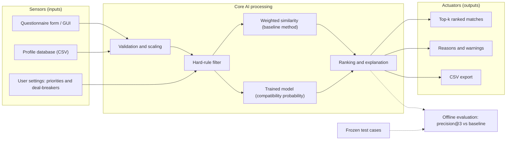

## Roommate Finder: Compatibility-Based Roommate Recommendation

### 1. Problem Statement

Students who share a room are often paired by chance or by first-come, first-served housing rules. Mismatched lifestyles, such as different sleep schedules, cleanliness standards, noise tolerance or snoring, are a common source of conflict, poor sleep and stress. Housing offices rarely have the time to compare lifestyle details by hand.

**Roommate Finder** is an intelligent agent that takes a student's lifestyle questionnaire and recommends the most compatible roommates from a pool of candidates. It applies hard rules first (for example, a severe snorer is never paired with a very light sleeper, and any deal-breakers the student sets are respected), then ranks the remaining candidates by a compatibility score and explains each recommendation in plain language.

**Scope:** an individual course prototype built on a small dataset (synthetic profiles created by the student, see the Data Card). It is not a deployed housing system and must not be used for real housing decisions.

**Target user:** students looking for a roommate.
**Input:** a questionnaire (sleep schedule, tidiness, noise tolerance, snoring, hobbies, budget or similar) plus optional priorities and deal-breakers.
**Output:** the top-k ranked matches with a score, reasons and any warnings.

---

### 2. PEAS Specification

| Element | Specification |
|---|---|
| **P**erformance measure | See 2.1 |
| **E**nvironment | See 2.2 |
| **A**ctuators | See 2.3 |
| **S**ensors | See 2.4 |

#### 2.1 Performance Measures

| Measure | Target |
|---|---|
| Ranking quality (precision@3 on a frozen test set) | Better than the baseline of counting matching answers |
| Top-3 hit rate on 10 hand-written test cases | At least 8 of 10 |
| Hard-rule violations in any output | 0 |
| Response time for one query | Under 1 second |
| Every recommendation includes at least one reason | 100% |
| Fairness | No sensitive attributes (religion, ethnicity, nationality) used as features |

#### 2.2 Environment

The task environment is the pool of student profiles plus the questionnaire answers the agent receives.

| Property | Classification | Justification |
|---|---|---|
| Observable | **Partially observable** | The agent only sees self-reported answers. It cannot observe real habits, personality changes or how two people would actually get along. |
| Deterministic | **Stochastic** | The real outcome of living together is uncertain, and answers are noisy. (The software computation itself is deterministic: the same input gives the same ranking.) |
| Episodic / sequential | **Episodic** | Each query is independent. A recommendation does not change how the next one is made. |
| Static / dynamic | **Static** | The candidate pool does not change while one recommendation is computed. (It would be semi-dynamic if new students could join between queries.) |
| Discrete / continuous | **Discrete** | Finite set of candidates, integer questionnaire scales, and a discrete action: choose a ranked list. |
| Agents | **Single-agent** | One recommender agent serves one query at a time. If the system later pairs everyone at once, other students' choices make it multi-agent. |
| Known / unknown | **Known** | The rules and scoring are defined by the designer. |

#### 2.3 Actuators

The agent has no physical actuators. It acts through software outputs:

- Ranked table of the top-k matches with a compatibility score
- Short reasons for each match ("similar sleep schedule") and warnings ("big gap in cleanliness")
- Exclusion of candidates who break a hard rule
- Optional export of results to a CSV file

#### 2.4 Sensors

The agent perceives its environment through software inputs:

- Questionnaire answers entered in the interface (sliders, checkboxes, form fields)
- User settings: importance of each factor and deal-breaker limits
- Candidate profile database (CSV file)
- Stored scoring settings or trained model file
- Optional feedback on past matches, if collected later

---

### 3. System Architecture

**How the flow works**

1. **Sensors** collect the student's answers, their settings and the candidate database.
2. **Validation and scaling** check the values and put all features on the same scale.
3. The **hard-rule filter** removes any candidate who breaks a rule or deal-breaker, so no score can override it.
4. **Scoring** compares the student with each remaining candidate using a weighted similarity (also the baseline) and, if included, a trained model.
5. **Ranking and explanation** sorts the candidates and generates reasons.
6. **Actuators** show the top-k list with reasons and warnings, and can export the results.
7. **Offline evaluation** (dashed) measures the system on frozen test cases and compares it with the baseline.
